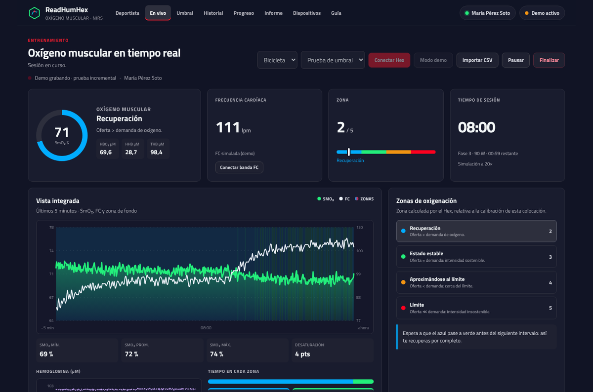
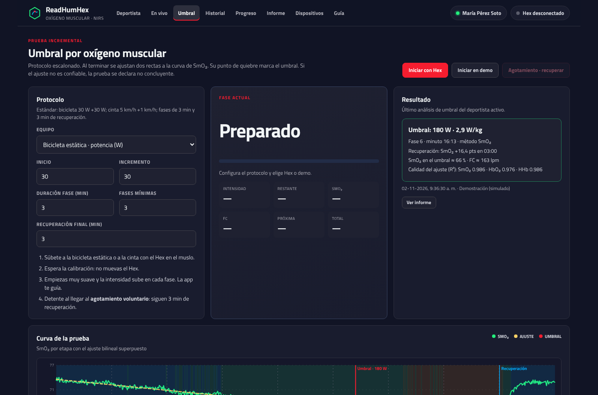
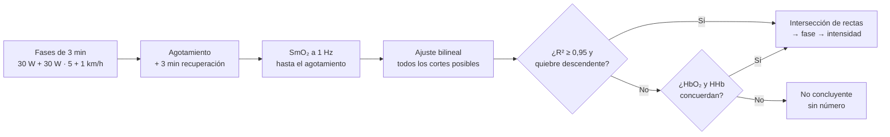
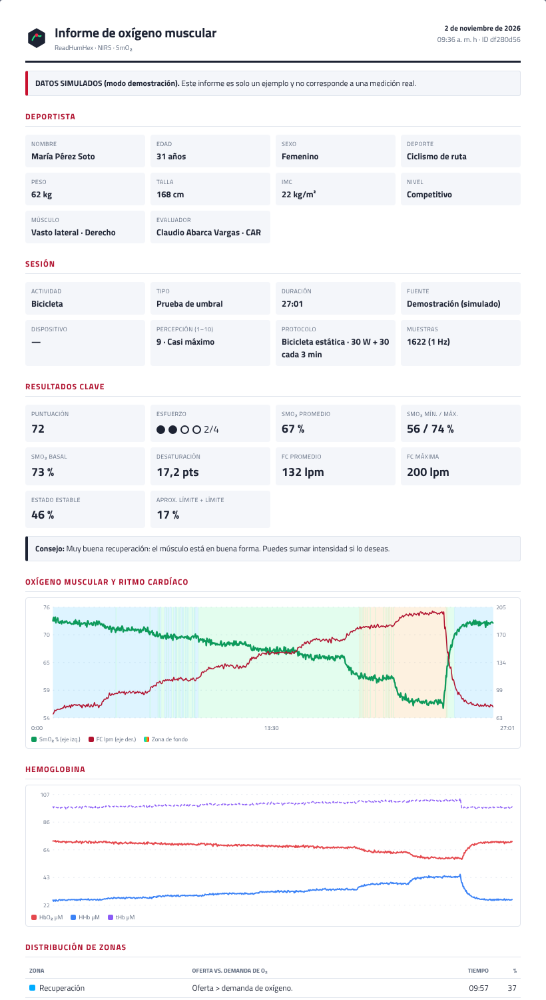
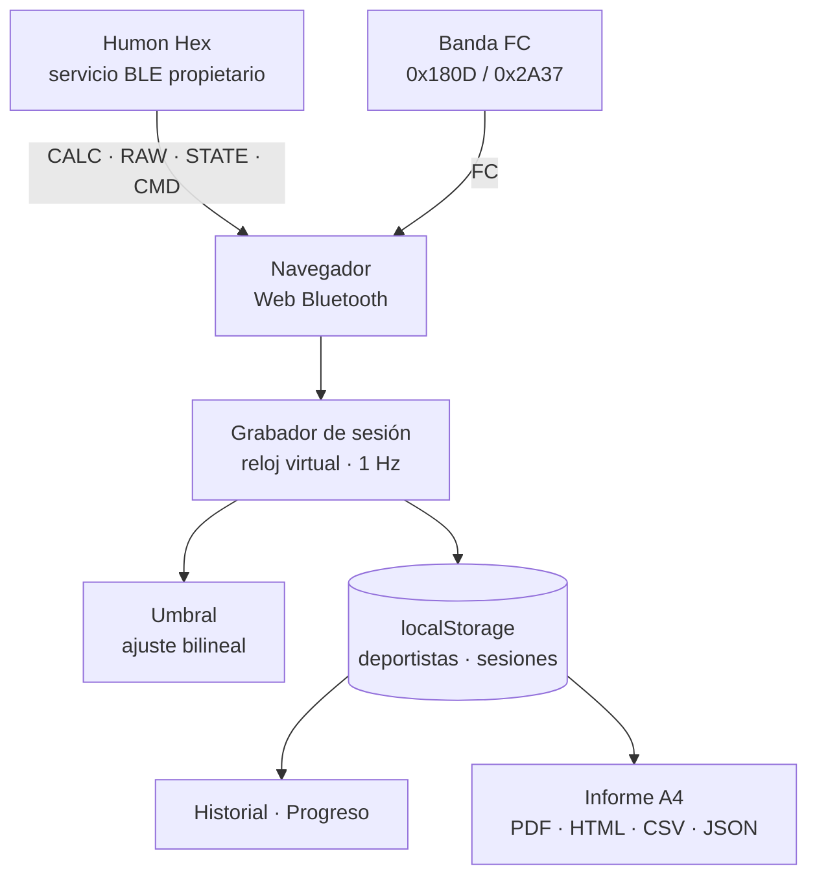

<div align="center">



# ReadHumHex

**Oxígeno muscular (SmO₂) en vivo desde el navegador, para el sensor NIRS Humon Hex**

[](https://csav20.github.io/readhumhex-web/)
[](#-uso)
[](#-qué-hace)
[](#-privacidad-y-datos)
[](https://csav20.github.io/readhumhex-web/)

### [▶ Abrir la app](https://csav20.github.io/readhumhex-web/) · [🧪 Probar el modo demo](https://csav20.github.io/readhumhex-web/#live) · [📄 Ver un informe](#-informe)

*Conecta, mide, evalúa e informa sin instalar nada. Todo pasa en el navegador.*

</div>

---

## ✨ Qué es

ReadHumHex es una aplicación web de **una sola página** que se conecta por **Web Bluetooth** al sensor de espectroscopia de infrarrojo cercano (NIRS) **Humon Hex**. Muestra en tiempo real la saturación muscular de oxígeno (**SmO₂**), la hemoglobina oxigenada y desoxigenada (**HbO₂ / HHb / tHb**) y la **zona de oxigenación** que calcula el propio sensor. Además, suma la **frecuencia cardíaca** de cualquier banda torácica estándar.

Agrega todo lo que una evaluación necesita: **fichas de deportistas**, **prueba incremental con umbral**, **historial**, **progreso** e **informe imprimible**. No usa servidor, cuentas ni dependencias externas: un solo archivo HTML publicado en GitHub Pages.

---

## 🧭 Qué hace

| Sección | Funciones |
|---|---|
| 👤 **Deportista** | Fichas con nombre, edad, sexo, peso, talla, deporte, nivel, músculo y lado evaluado, evaluador y observaciones. Cada sesión queda asociada al deportista activo. |
| 📡 **En vivo** | Actividad (Correr, Bicicleta, Remo, Otro) y tipo (Intervalo, Resistencia, Prueba de umbral). SmO₂ sin decimales, HbO₂, HHb y tHb en tiempo real; zona del Hex; FC de banda externa; gráfico de 5 min con zonas de fondo; tiempo en cada zona. |
| 📈 **Umbral** | Prueba guiada en bicicleta estática (30 W + 30 W) o cinta (5 km/h + 1 km/h), fases de 3 min hasta el agotamiento voluntario y 3 min de recuperación. Estima el umbral con un **ajuste bilineal de dos segmentos**; si el ajuste no es confiable, declara la prueba **no concluyente**. |
| 🗂️ **Historial** | Por sesión: **Puntuación**, **Esfuerzo** (0–4 puntos), **Consejo**, rango mín./promedio/máx., distribución de zonas, gráficos de oxígeno muscular, hemoglobina y ritmo cardíaco, percepción del entrenamiento (1–10) y notas. |
| 📊 **Progreso** | Entrenamientos #, tiempo de entrenamientos, entrenamientos/semana y tiempo/semana; puntuación y duración en el tiempo; SmO₂ mín./prom./máx. por sesión; evolución del umbral; distribución de zonas acumulada; tabla comparativa. |
| 📄 **Informe** | Documento A4 listo para **imprimir o guardar en PDF**, con datos del deportista, resultados clave, gráficos, tabla de zonas, umbral con la curva ajustada, tabla de etapas, síntesis y firmas. También se descarga como **HTML, CSV o JSON**. |
| ⚙️ **Dispositivos** | Hex y monitor de FC por separado; modelo, fabricante, número de serie, versiones de hardware y firmware; batería con aviso al 10 %; estado y calibración del Hex; tasa de paquetes por característica BLE; diagnóstico exportable; respaldo e importación de todos los datos. |
| 🧪 **Modo demo** | Datos simulados (siempre rotulados como tales) a 1×–20× de velocidad para probar todo sin sensor, incluso en iPhone. |

<div align="center">

</div>

---

## ✅ Coherencia con la app oficial (Humon 1.19.0)

Contenido y cálculos verificados contra la app oficial de Android (versión 1.19.0), para que los datos y su lectura sean los mismos que ve un usuario de Humon:

| Elemento | Cómo queda en ReadHumHex |
|---|---|
| Zonas | 2 Recuperación (azul `#00ACFF`) · 3 Estado estable (verde `#23EF7B`) · 4 Aproximándose al límite (naranja `#F39412`) · 5 Límite (rojo `#FF001F`). Zonas 0–1 sin clasificar («—»). La zona la envía el Hex; no se recalcula. |
| Lectura de zonas | Azul: oferta > demanda · Verde: oferta = demanda (sostenible) · Naranja: oferta < demanda · Rojo: oferta ≪ demanda (insostenible). |
| SmO₂ en vivo | Valor entero (sin decimales), desde la característica CALC. |
| Actividad y tipo | Correr · Bicicleta · Remo · Otro; Intervalo (esfuerzos de menos de 2 min) · Resistencia · Prueba de umbral. |
| Prueba de umbral | Fases de 180 s; bicicleta 30 W + 30 W; cinta 5 km/h + 1 km/h; 180 s de recuperación; solo bicicleta y carrera. |
| Puntuación | Misma ponderación por fracción de tiempo en cada zona (bajo 75 = poco óptima; sobre 100 = muy optimizada). |
| Esfuerzo y consejo | Mismos cortes de fracción por zona (recuperación > 14 %, estable > 73 %, aproximándose > 8 %, límite > 5 %) para 0–4 puntos y 16 casos de consejo (textos propios). |
| Percepción | Escala 1–10 al terminar el entrenamiento, más notas. |
| Batería | Aviso de batería baja al 10 %. |
| FC | Siempre desde un segundo periférico (monitor de FC Bluetooth); el Hex no la mide. |

ReadHumHex usa su propia marca, logotipo y redacción. No incluye código, imágenes ni textos de la app oficial.

---

## 🚀 Uso

### Opción 1: directo en el navegador (recomendado)

```
https://csav20.github.io/readhumhex-web/
```

1. Abre el enlace en **Chrome o Edge** (computador o Android).
2. En **Deportista**, crea la ficha y déjala activa.
3. Enciende el Hex, colócalo sobre el vientre muscular (p. ej., vasto lateral) y pulsa **Conectar Hex**.
4. Elige actividad y tipo, y espera «Calibrando…» (oscuridad → potencia del LED) **sin mover el Hex**. La grabación empieza sola cuando el Hex queda activo.
5. Opcional: **Conectar banda FC** para sumar la frecuencia cardíaca.
6. **Finalizar** pide la percepción del entrenamiento (1–10) y notas, guarda la sesión con su puntuación, esfuerzo y consejo, y abre el **Informe**.

> Sin sensor a mano: pulsa **Modo demo** en *En vivo* o **Iniciar en demo** en *Umbral*.

| Plataforma | Bluetooth (Hex y banda) | Demo, historial e informes |
|---|---|---|
| Chrome / Edge en Windows, macOS, Linux, ChromeOS | ✅ | ✅ |
| Chrome en Android | ✅ | ✅ |
| Safari / cualquier navegador en iPhone o iPad | ❌ (Apple no ofrece Web Bluetooth) | ✅ |
| Navegador interno de WhatsApp, Instagram, etc. | ❌ — usa «Abrir en Chrome» | ✅ |

### Opción 2: clonar y abrir localmente

```bash
git clone https://github.com/Csav20/readhumhex-web.git
cd readhumhex-web
# Web Bluetooth exige HTTPS o localhost:
python3 -m http.server 8000 --directory docs
# abrir http://localhost:8000
```

> Abrir `docs/index.html` desde github.com muestra el código, no la app. Usa el enlace de GitHub Pages.

---

## 📈 Prueba de umbral



- Para cada punto de corte posible se ajusta una recta a cada lado (mínimos cuadrados). Se elige el corte con menor error total, y la **intersección de las dos rectas** da el tiempo de umbral, que se asigna a la fase en curso. La recuperación no entra en el ajuste; se informa aparte como reoxigenación (puntos de SmO₂ recuperados).
- **Criterio de aceptación:** R² del modelo bilineal ≥ 0,95 para SmO₂ y pendiente posterior más negativa. **Respaldo:** HbO₂ (R² ≥ 0,76, cae más) y HHb (R² ≥ 0,26, sube más), con quiebres a menos de una etapa entre sí.
- Se requieren al menos 3 fases completas (configurable).
- Si nada pasa el criterio, la app **no entrega un número**: un umbral con mal ajuste sería engañoso.

---

## 📄 Informe

<div align="center">

</div>

El informe incluye: datos del deportista (edad, IMC, músculo evaluado), datos de la sesión (protocolo, dispositivo, percepción 1–10), resultados clave (puntuación, esfuerzo, consejo; SmO₂ promedio, mínima, máxima, basal y desaturación; FC; tiempo en estado estable y cerca del límite), gráficos de SmO₂ + FC y de hemoglobina, distribución por zonas, umbral con la curva ajustada, tabla por fase y recuperación, síntesis automática, notas y firmas. Los informes de sesiones demo llevan un aviso de **datos simulados**.

**Exportaciones**

| Formato | Contenido |
|---|---|
| PDF | Desde *Imprimir / PDF* (A4, solo el informe) |
| HTML | Informe autocontenido para enviar por correo |
| CSV | `tiempo_s, smo2, hbo2, hhb, thb, zona, fc, intensidad` a 1 Hz, con cabecera de metadatos |
| JSON | Sesión completa más la ficha del deportista |
| RAW CSV | Cuentas ópticas crudas del Hex (opcional al finalizar) |
| Respaldo | Todos los deportistas y sesiones (`.json`), importable en otro navegador |

**Importar CSV:** cualquier archivo con una columna `smo2` (y opcionalmente `tiempo_s`, `hbo2`, `hhb`, `zona`, `fc`, `intensidad`; separador coma, punto y coma o tabulación) o una sola columna de SmO₂ a 1 muestra por segundo.

---

## 📡 Arquitectura



| Capa | Tecnología |
|---|---|
| Interfaz | HTML5 · CSS3 · JavaScript (un solo archivo, sin frameworks) |
| Gráficos | SVG propio (curvas Catmull‑Rom), sin librerías |
| Conectividad | Web Bluetooth API: dos periféricos independientes |
| Persistencia | `localStorage` del navegador más respaldo `.json` |
| Publicación | GitHub Pages desde `main:/docs` |

### Protocolo del Hex (resumen)

Datos en little‑endian, sobre un servicio propietario `0000f00d-…`. Ninguna característica es legible; todo llega por notificación.

| Característica | Uso | Formato |
|---|---|---|
| `0000deef` CALC | Valores calculados | 4 × float32: HHb (µM), HbO₂ (µM), SmO₂ (0–1), zona (0–5) |
| `0000beef` RAW | Señal óptica | 8 × uint16: cuentas de las cadenas A y B |
| `0000abcd` CMD | Comandos | opcode de 1 byte; respuesta por notificación, una petición a la vez |
| `0000abc0` STATE | Estado | 1 byte: reposo, calibración de oscuridad, calibración de potencia, activo, completo, apagado |

El Hex **no mide frecuencia cardíaca**: la FC llega siempre de una banda externa con el perfil estándar Heart Rate. La app no muestra datos hasta que el Hex informa estado activo y calibración leída. Además, descarta paquetes en que HbO₂/tHb no concuerda con la SmO₂.

---

## 🔒 Privacidad y datos

- Todo se procesa y se guarda **solo en el navegador** donde se usa la app. No hay servidor ni cuentas, y nada se envía a terceros.
- Los datos sobreviven a recargas, pero se borran si se limpian los datos del sitio. Para trasladar o resguardar la información, usa **Dispositivos → Exportar respaldo**.
- Capacidad típica: unos 5 MB (decenas de sesiones de una hora a 1 Hz).

---

## ⚠️ Alcance

Herramienta de visualización y registro para entrenamiento, docencia e investigación. **No es un dispositivo médico ni entrega diagnósticos.** Las zonas las calcula el firmware del Hex, relativas a la calibración de cada colocación. El umbral es una estimación por ajuste bilineal y se informa como no concluyente cuando el ajuste es pobre.

ReadHumHex es un **cliente independiente**, sin afiliación con Humon ni con Dynometrics. «Humon» y «Hex» son marcas de sus respectivos titulares. La compatibilidad se logró por interoperabilidad con un sensor adquirido legítimamente.

---

## 🔮 Hoja de ruta

- [x] SmO₂, HbO₂, HHb y zonas en vivo por Web Bluetooth
- [x] Banda de FC independiente
- [x] Fichas de deportistas, historial y progreso
- [x] Prueba incremental con umbral bilineal y criterio de no concluyente
- [x] Informe A4 (PDF/HTML) y exportación CSV/JSON
- [x] Modo demostración
- [ ] Varios Hex simultáneos (bilateral o multimúsculo)
- [ ] Marcadores de evento durante la sesión
- [ ] Integración con potenciómetro BLE (Cycling Power 0x1818)
- [ ] Versión instalable (PWA) con funcionamiento sin conexión

---

## 👨‍🔬 Autor

<div align="center">

**ActionSmart® — Claudio Abarca Vargas, PhD**

Doctor en Ciencias de la Motricidad Humana · ACTIONSMART® Research Lab · Centro de Alto Rendimiento de Chile

🇨🇱 Santiago, Chile · [csav20@gmail.com](mailto:csav20@gmail.com) · [claudio.abarca@ind.cl](mailto:claudio.abarca@ind.cl)

[](https://github.com/Csav20)
[](https://www.linkedin.com/in/pabarca)
[](https://www.instagram.com/claudio_abarca_vargas)

*"La ciencia aplicada al deporte y la salud"*

Desarrollado con la asistencia de IA: Claude (Anthropic)

</div>

---

## ☕ Invítame un café si lo deseas

Si ReadHumHex te resulta útil en tu laboratorio, club o investigación, puedes apoyar su desarrollo con un café vía PayPal:

<div align="center">

[](https://www.paypal.com/donate/?business=csav20%40gmail.com&currency_code=USD)

**PayPal:** `csav20@gmail.com`

</div>

---

## 📜 Licencia

© 2026 Claudio Abarca Vargas. Todos los derechos reservados. Ver [`LICENSE`](LICENSE).

Versión 1.1.0 · 2026‑11‑02
